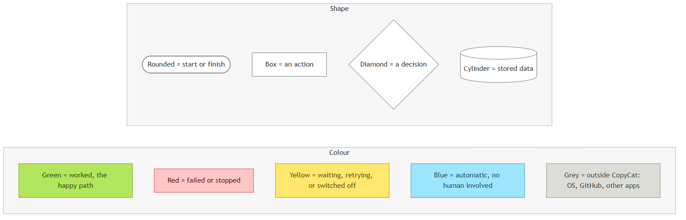
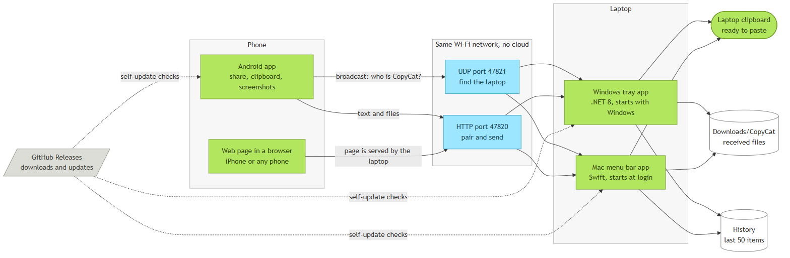
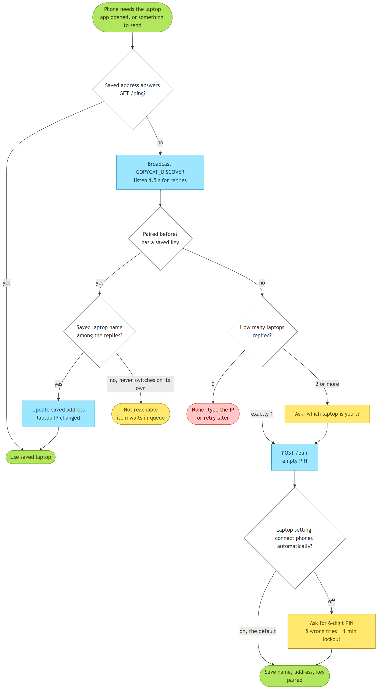
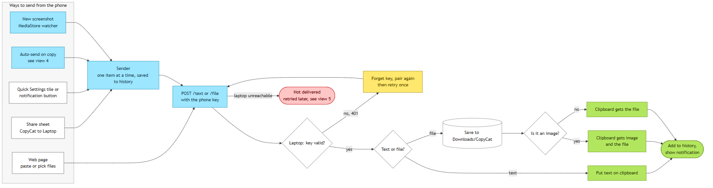
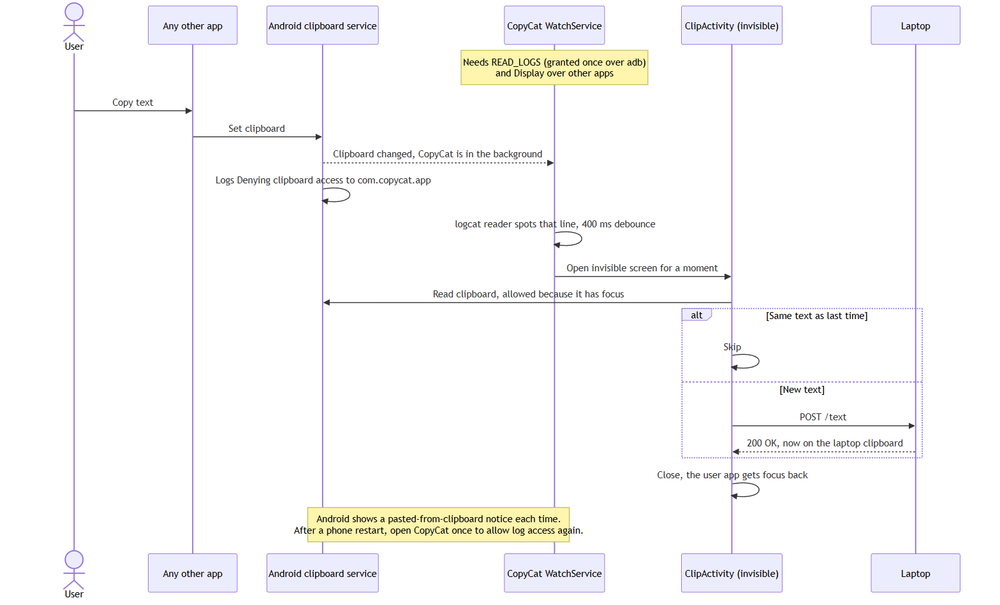
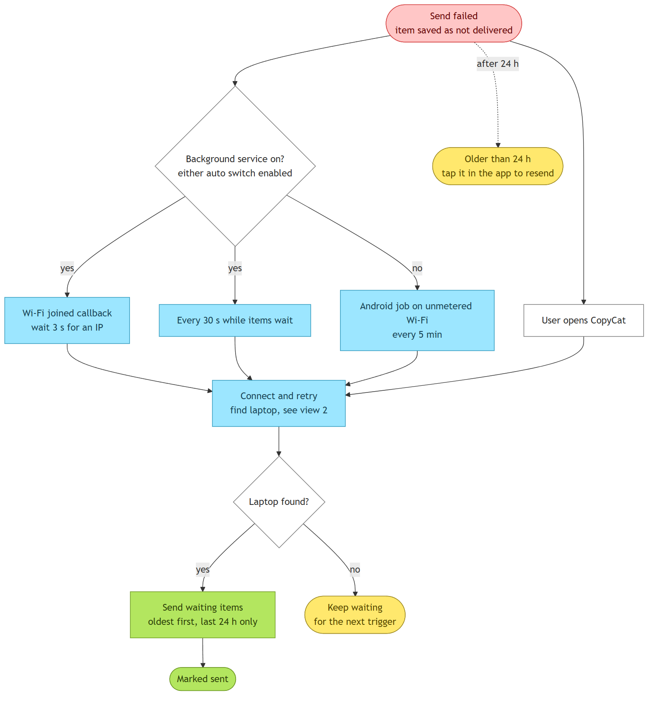
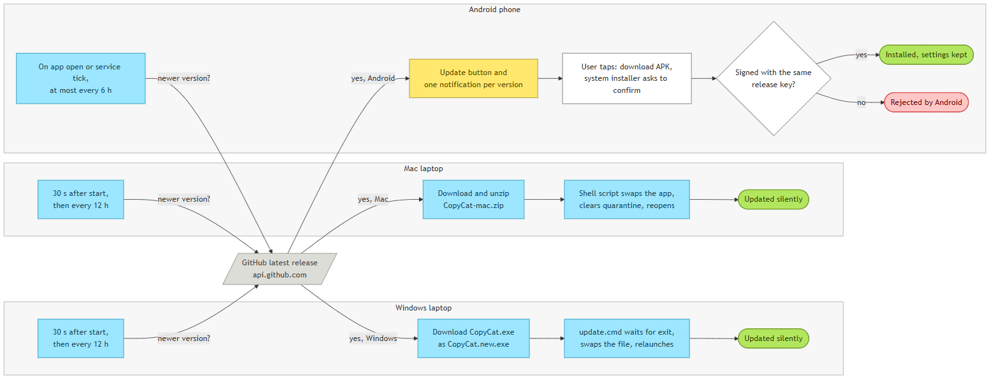
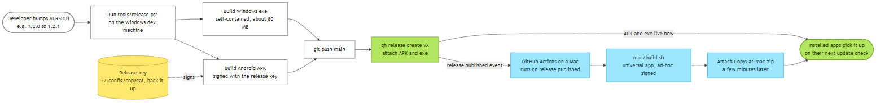

# CopyCat: knowledge handover

*Version described: v1.2.0 · written 2026-10-20*

CopyCat sends whatever you copy, share or screenshot on a phone straight to a laptop's clipboard, over the same Wi-Fi. There's no account and no cloud: the phone talks directly to the laptop. GitHub is only used to host downloads and updates.

| | Link |
|---|---|
| Code | <https://github.com/BeathovenGala/copycat> |
| Latest downloads | <https://github.com/BeathovenGala/copycat/releases/latest> |
| Miro board (all diagrams, editable) | <https://miro.com/app/board/uXjVEX6DqZg=/> |

**Platform status**

| Piece | Tech | Status |
|---|---|---|
| Android app | Kotlin, framework only, no AndroidX | Shipped and tested on a OnePlus Nord CE 3 Lite (CPH2467), Android 14 |
| Windows laptop app | .NET 8 WinForms tray app + Kestrel | Shipped and tested on Windows 11 |
| Phone web page (for iPhone) | Single HTML file served by the laptop | Tested from a desktop browser and with HTTP calls; **not yet tried on a real iPhone** |
| Mac laptop app | Swift 5.9, AppKit, Network.framework | Builds on GitHub Actions; **never run on a real Mac** |
| Native iOS app | Not built | Blocked by Apple: needs a $99/yr developer account, and iOS forbids background clipboard reads anyway |

---

## 1. How to read the diagrams

Every diagram uses the same colours and shapes. They're in `diagrams/` as editable Mermaid source (`.mmd`), SVG and PNG, and on the Miro board.



---

## 2. System overview



- **Phone side.** The Android app has every feature. Any other phone, including an iPhone, opens a web page that the laptop serves itself.
- **Network.** Two ports on the laptop: **UDP 47821** answers "is there a CopyCat here?" broadcasts, and **HTTP 47820** handles pairing and sending. It's plain HTTP on the local network; nothing leaves the Wi-Fi.
- **Laptop side.** The Windows and Mac apps speak the **same protocol**, so the Android app and the web page work with either. Received text goes on the clipboard. Received files are saved to `Downloads/CopyCat`, and images also go on the clipboard. The last 50 items are kept in a history menu.
- **GitHub.** Only used for downloads and self-updates.

---

## 3. Finding and pairing the laptop



- This runs whenever the phone needs the laptop: when the app opens, and before any send whose saved address doesn't answer (`Net.ensurePaired`).
- **Discovery:** the phone sends the UDP text `COPYCAT_DISCOVER` twice, to `255.255.255.255` and to the Wi-Fi subnet broadcast, then listens for 1.5 s. Each laptop replies with JSON `{"app":"copycat","name":"<machine name>","port":47820}`.
- **Pairing:** `POST /pair` with an empty PIN. By default the laptop auto-accepts and returns a random 48-hex-character **key** (token). The phone stores the laptop name, address and key.
- **Safety rule:** once paired, the phone only ever reconnects to the laptop **with the same name**. It never switches to another laptop on its own, for example a colleague's on office Wi-Fi. **Find laptop** in the app is the only way to switch.
- **PIN mode:** if the laptop owner turns off *Connect new phones automatically*, pairing needs the 6-digit PIN shown in the tray or menu bar. After 5 wrong PINs, pairing is locked for 1 minute.

---

## 4. Sending something



- **Five ways in:** the share sheet (`ShareActivity`), the Quick Settings tile and notification button (`ClipTileService` and `ClipActivity`), auto-send on copy (view 5), the screenshot watcher (`Screenshots`), and the web page.
- On Android, everything goes through **`Sender`**. It's a single worker thread, so items go out one at a time in order, and each one is written to history with a sent or not-delivered flag. Shared files are **copied into the app's own storage first**, because Android revokes access to a shared file when the share screen closes.
- **Laptop side:** `POST /text` puts the text on the clipboard. `POST /file?name=…` saves the file to `Downloads/CopyCat`, giving it a unique name if one already exists. Images are put on the clipboard as both the image and the file, so pasting works in chat apps and in Explorer or Finder.
- A **401** means the laptop forgot this phone, for example after *Unpair all phones*. The phone drops its key, pairs again, and retries once.

---

## 5. Auto-send on copy (the Android trick)



- **The problem:** since Android 10, background apps can't read the clipboard.
- **The workaround, the same one KDE Connect uses:** when the clipboard changes, Android writes a line to the system log refusing access to background listeners. With the `READ_LOGS` permission (granted once over adb), `WatchService` reads the log, spots `Denying clipboard access to com.copycat.app`, and for a split second opens an invisible screen (`ClipActivity`). Having focus, that screen can read the clipboard, so it reads it and closes.
- **Requirements:**
  - `READ_LOGS` over adb. On OnePlus, Oppo and Realme phones, first enable *Developer options → Disable permission monitoring*.
  - *Display over other apps*, so the app can open a screen from the background.
- **Side effects users will notice:**
  - Android 13+ shows "CopyCat pasted from your clipboard" each time.
  - After a phone restart, Android asks again for one-time log access, which only works while the app is open. So the user must open CopyCat once after each reboot.
- **Not available on iPhone at all.**

---

## 6. Offline queue and reconnect



- A send that fails is kept as **not delivered**. Nothing is lost while the phone and laptop are apart.
- **With the background service running** (either auto switch on): an in-process Wi-Fi callback runs the retry 3 s after joining any Wi-Fi, plus a 30 s tick while items are waiting.
- **With the service off:** an Android `JobScheduler` job runs on unmetered Wi-Fi, retrying every 5 min while items wait. Opening the app also retries immediately.
- Only items from the **last 24 hours** are retried, oldest first. Older ones stay in the Recent list, and tapping one resends it.
- **Gotcha we hit:** `registerNetworkCallback(PendingIntent)` looked like the way to wake the app on Wi-Fi changes, but Android **delivers it once and then drops the registration**. That's why the instant reconnect needs the service.

---

## 7. Auto-updates



- Every app asks `https://api.github.com/repos/BeathovenGala/copycat/releases/latest` and compares the release tag (`vX.Y.Z`) with its own version.
- **Windows:** checks 30 s after start, then every 12 h. It downloads `CopyCat.exe` as `CopyCat.new.exe`, writes `update.cmd`, and quits. The script waits until the file is unlocked, swaps it in and relaunches. The install path never changes, so the firewall rule and the startup entry keep working.
- **Mac:** same timing. It downloads `CopyCat-mac.zip`, unzips it with `ditto`, and a shell script waits for the app to exit, replaces `CopyCat.app`, clears the quarantine flag and reopens it.
- **Android:** checks at most every 6 h, when the app opens or on a service tick. It shows an *Update to vX* button and one notification per version. Tapping downloads the APK and hands it to Android's `PackageInstaller`, which always asks the user to confirm.
- **Critical:** Android only accepts an update **signed with the same key**. See section 10.

---

## 8. Shipping a new version



1. Change the code and commit.
2. Bump the single version number in `VERSION`, for example `1.2.0` → `1.2.1`. Android's versionName and versionCode and the Windows assembly version are both read from it.
3. Run `tools/release.ps1 -Notes "what changed"` on the Windows dev machine. It:
   - builds the signed release APK and the self-contained Windows exe (about 80 MB),
   - pushes `main`,
   - creates GitHub release `vX.Y.Z` with `CopyCat.apk` and `CopyCat.exe`.
4. The **release published** event triggers `.github/workflows/mac.yml`. GitHub's Mac runner builds the universal app with `mac/build.sh` and attaches `CopyCat-mac.zip` a few minutes later.
5. Installed apps pick the new version up on their next update check.

The release script authenticates with `gh auth token -u BeathovenGala`, so the GitHub CLI must be logged in to that account. It refuses to run if the tag already exists.

---

## 9. Protocol reference

Both laptop apps implement exactly this. The phone app and the web page depend on it.

| Call | Auth | Request | Response |
|---|---|---|---|
| UDP `COPYCAT_DISCOVER` → port 47821 | none | the literal text | JSON `{app, name, port}` sent back to the sender |
| `GET /` | none | | the phone web page (`web/index.html`) |
| `GET /ping` | none | | `{"app":"copycat","name":…}` |
| `POST /pair` | none | JSON `{"pin":"", "device":"…"}` | `200 {token, name}` · `403` PIN needed or wrong · `429` locked for 1 min |
| `POST /text` | `X-CopyCat-Token` | UTF-8 text body | `200` · `401` unknown key · `400` empty |
| `POST /file?name=<file name>` | `X-CopyCat-Token` | raw bytes, `Content-Type` set | `200` · `401` · `413` over 512 MB |

Optional header `X-CopyCat-Device`: a display name for notifications and history, for example the phone model.

---

## 10. Where things live

| What | Where |
|---|---|
| Windows install | `%LOCALAPPDATA%\Programs\CopyCat\CopyCat.exe`. The downloaded exe copies itself here on first run. |
| Windows start-up | Registry `HKCU\Software\Microsoft\Windows\CurrentVersion\Run` → `CopyCat` |
| Windows firewall | Inbound rule "CopyCat" for that exe. Tray → Settings → *Allow through firewall* (needs admin). |
| Laptop settings and paired keys | Windows `%APPDATA%\CopyCat\config.json` · Mac `~/Library/Application Support/CopyCat/config.json` |
| Laptop history | `history.json` next to the config (last 50 items) |
| Laptop error log (Windows) | `%APPDATA%\CopyCat\error.log`. Server start failures are written here. |
| Received files | `Downloads/CopyCat` |
| Phone settings, key and history | App-private SharedPreferences `copycat` (last 30 items); copies of sent files in `files/history/` |
| **Android release signing key** | `C:\Users\has20\.config\copycat\release.jks` + `signing.properties` (passwords). **Outside the repo. Back it up.** If it's lost, existing installs can never update and users must uninstall and reinstall. |

---

## 11. Repository map

```
VERSION                 single version number for every app
README.md               user-facing install and usage guide
tools/release.ps1       build + publish a release
tools/make-icon.ps1     generates desktop/copycat.ico and tools/icon-512.png
web/index.html          phone web page (embedded in both laptop apps)
android/                Android app (Gradle, AGP 9.1, compileSdk 36, minSdk 26)
  MainActivity.kt         main screen: status, switches, history, update button, laptop picker
  ShareActivity.kt        share-sheet target (text, images, any files, multiple)
  ClipActivity.kt         invisible screen that reads the clipboard while focused
  ClipTileService.kt      Quick Settings tile "Send clipboard"
  WatchService.kt         foreground service: log watcher, screenshots, Wi-Fi reconnect, retries
  Screenshots.kt          MediaStore observer for new screenshots
  Sender.kt               single-thread send queue, history, retry logic
  Net.kt                  discovery, pairing, HTTP client
  RetryJob.kt             JobScheduler fallback retry on Wi-Fi
  Updater.kt              GitHub update check + PackageInstaller install
  Prefs.kt / BootReceiver.kt
desktop/                Windows app (.NET 8)
  Program.cs              single instance, self-install
  TrayApp.cs              tray menu, clipboard, notifications, QR window, update loop
  Server.cs               Kestrel HTTP endpoints + UDP discovery
  Store.cs / Startup.cs / Updater.cs
mac/                    Mac app (Swift package, built on CI)
  Sources/CopyCat/        AppDelegate (menu bar), HTTPServer, Router, Discovery, Clipboard, Store, Updater
  build.sh / Info.plist
.github/workflows/mac.yml   builds the Mac app on push and attaches it to releases
docs/handover/          this document and the diagrams
```

---

## 12. Security model and known risks

- **Traffic is plain HTTP on the local network, unencrypted.** Anyone on the same Wi-Fi who can sniff traffic can read what's sent. Fine at home, not on public Wi-Fi.
- **Auto-accept is on by default.** Any device on the same Wi-Fi running CopyCat, or anyone who knows the protocol, can pair and push text or files to the laptop. Turn off *Connect new phones automatically* on untrusted networks to require the PIN.
- **Keys** are random 24-byte values, stored in plain JSON on the laptop and in app-private storage on the phone. *Unpair all phones* revokes them all.
- **`READ_LOGS`** gives CopyCat access to all device logs. It's only used to spot the clipboard line, but it's a powerful permission. Grant it knowingly.
- **Received files** are saved under a sanitised name (path parts stripped) in `Downloads/CopyCat`, and are never executed.
- **The web page** shows the pairing key under *Use with Apple Shortcuts*, so anyone holding the phone can copy it.
- **Builds aren't code-signed** for Windows SmartScreen or Apple notarization, so users see "unknown developer" warnings on first install.

---

## 13. What's been tested, and what hasn't

| Tested end to end | Not tested |
|---|---|
| Android → Windows text, screenshot and file delivery over Wi-Fi | Mac app running at all |
| Auto-pairing with no PIN | Web page on a real iPhone, and Shortcuts |
| Offline screenshot delivered automatically after Wi-Fi came back | "Which laptop is yours?" picker (only one laptop was available) |
| Windows self-install from the downloaded exe, and self-update (1.1.0 → 1.1.1 → 1.1.2 → 1.2.0) | Phone self-update via the in-app button (code path built, never tapped) |
| Wi-Fi rejoin trigger inside the background service | PIN pairing mode |
| Windows web page + browser pairing | Big files near the 512 MB limit |

There are **no automated tests yet**. Everything above was verified by hand on real devices.

---

## 14. Gotchas we hit (read before changing things)

1. **OnePlus/ColorOS blocks `adb pm grant`** until *Disable permission monitoring* is on in Developer options.
2. **Android 13+ log access** needs a one-time approval that only works while the app is in the foreground, so `MainActivity.onResume` restarts the log reader.
3. **One-shot `PendingIntent` network callbacks** (section 6). Don't go back to them.
4. **Windows networks are often "Public"**, so the firewall blocks inbound connections until the CopyCat rule is added.
5. **PowerShell 5.1 treats anything on stderr as an error** when `$ErrorActionPreference = "Stop"`, and `git` and `gh` write progress to stderr. The release script uses `Continue` and checks `$LASTEXITCODE`.
6. **Dev builds must not self-install.** A non-single-file build is just a small launcher next to `CopyCat.dll`; copying it over the real install broke it once. `Program.IsDevBuild()` guards against this.
7. **C# static field order:** `Updater.Current` must be declared before the `HttpClient` that reads it. v1.1.0 crashed on start because of this.
8. **Swift concurrency:** closures passed to `Timer` are `@Sendable`, so capturing `self` in them is a compile error. Use a `Task` loop instead.
9. **Release-signed vs debug-signed APKs** can't update each other. Switching once required an uninstall, which wipes the phone app's settings.

---

## 15. Ideas for next steps

- Ask for the auto-copy permissions from the laptop app over USB, so friends don't need adb.
- Send in the other direction, laptop → phone (the protocol would need a phone-side listener or polling).
- Encrypt traffic: TLS with a key pinned at pairing time, or encrypt the payload with the pairing key.
- Automated tests for the HTTP parser (Mac), `Net.ensurePaired` decisions, and the protocol contract shared by both laptops.
- Code signing (Windows Authenticode, Apple Developer ID) to remove the install warnings.
- A real iPhone app via TestFlight, if a developer account becomes available (share sheet extension only).

---

## 16. Re-generating the diagrams

```
cd docs/handover/diagrams
# edit make_sources.py (the single source for all .mmd files), then:
powershell -File render.ps1        # writes .mmd, .svg and .png (needs Node + Chrome)
python make_board_svg.py           # writes board.svg for the Miro board
```

The Miro board was created from `board.svg`. Edit diagrams there directly, or update the sources and recreate.
